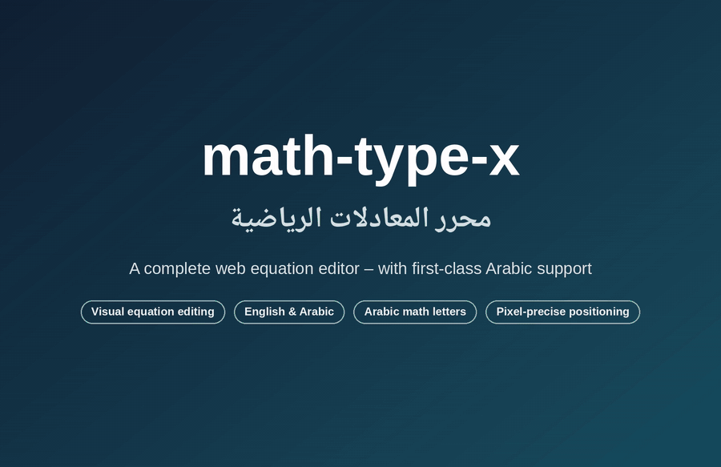
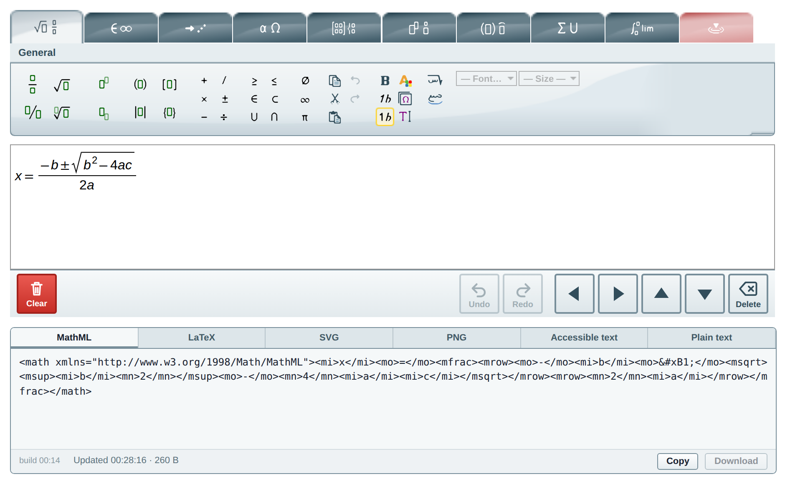
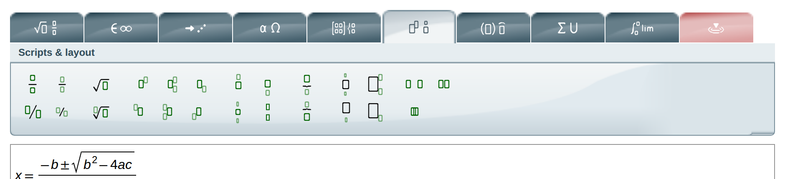
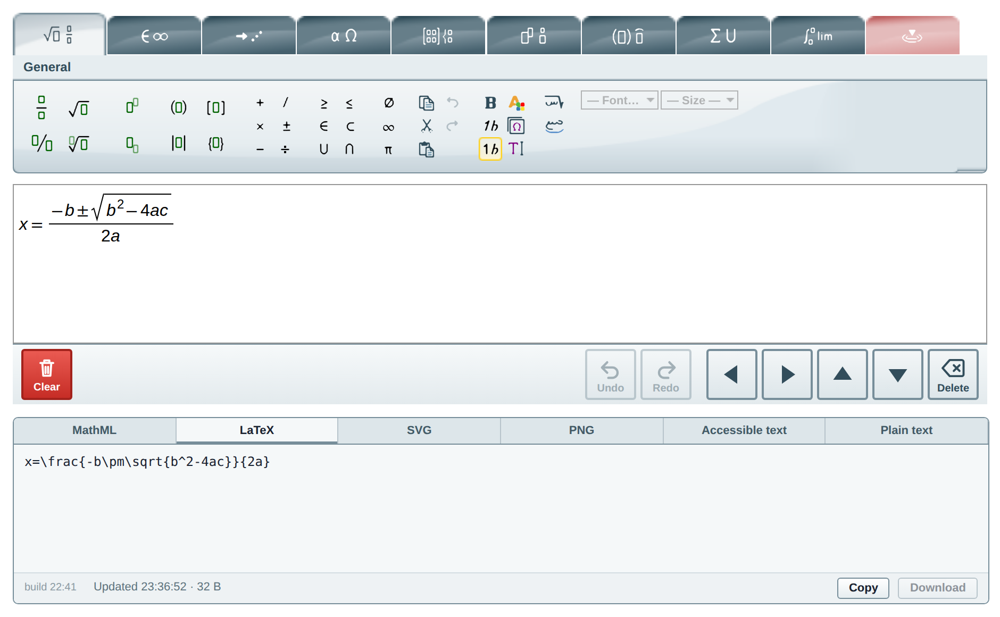
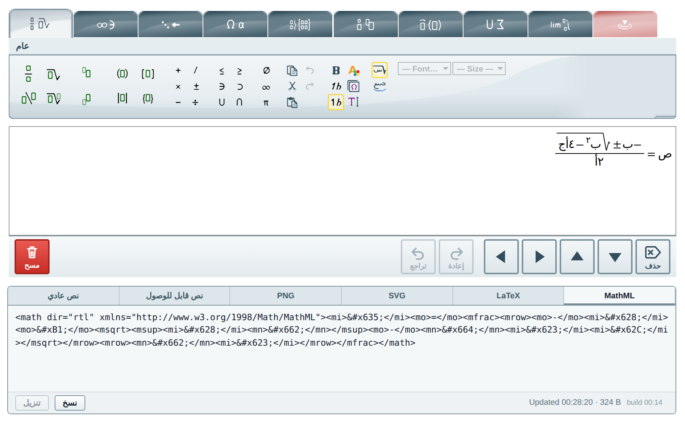
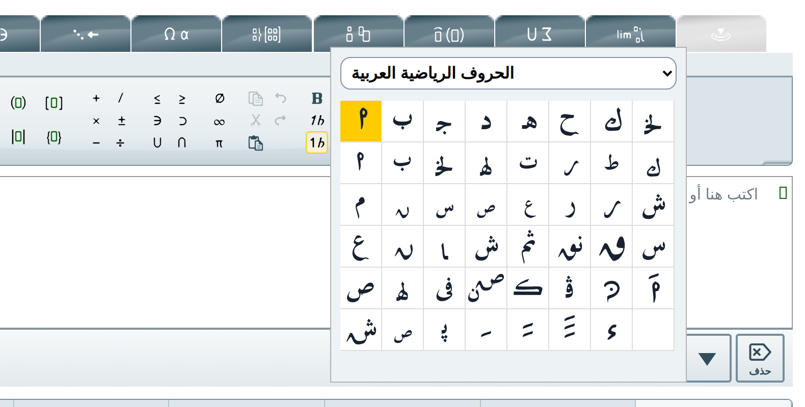
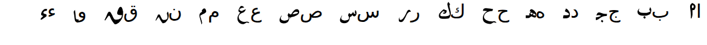
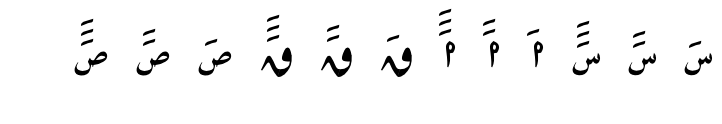
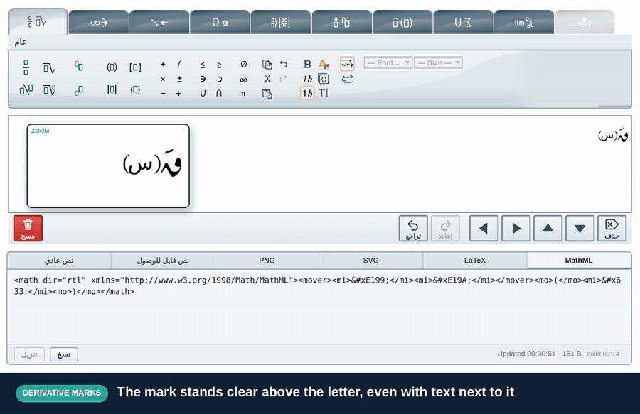
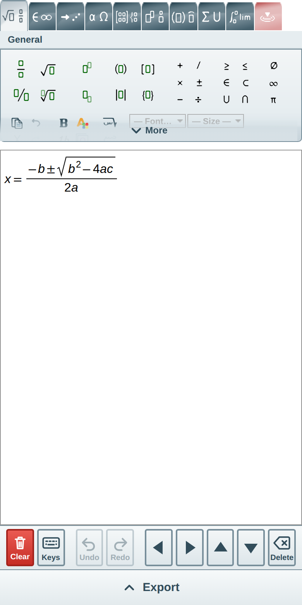

<div align="center">

# math-type-x

**A complete web equation editor – with first-class Arabic support.**

Click or type a formula, keep it as MathML, and export it as LaTeX, PNG, SVG or spoken text.
Full English interface out of the box – and, as a feature of its own, right-to-left Arabic with the Arabic math letters.

<br>



<sub>56-second tour, no sound · <a href="docs/media/demo.mp4">watch it in full quality (MP4)</a></sub>

<br>


[Features](#features) · [Arabic mathematics](#arabic-mathematics) · [Quick start](#quick-start) · [Use it on your site](#use-it-on-your-website) · [Documentation](#documentation)

</div>

---

## Why math-type-x?

* **It feels like a word processor for equations.** A toolbar with 700 ready-made structures, a keyboard shortcut for
  everything, and a live preview – no code to learn.
* **Complete in English, outstanding in Arabic.** The full editor works in English; switch to Arabic and the whole interface,
  the typing rules, the layout and the exports work right to left, with Arabic mathematical letters built in.
* **Your formulas are yours.** Everything is stored as standard MathML, so it works in Word, web pages, e-books and other
  editors, and exports to LaTeX, images and accessible text.
* **Nothing to install for readers.** It is a web page: it runs in any modern browser on a computer, a tablet or a phone.

## Features

<table>
<tr>
<td width="50%" valign="top">

### Build formulas by clicking or typing
Fractions, roots, powers, matrices, integrals, sums, limits, long division – pick them from the toolbar or type them.
Undo and redo, copy and paste, bold and italic, colours and sizes all behave as you expect.

</td>
<td width="50%" valign="top">



</td>
</tr>
<tr>
<td width="50%" valign="top">



</td>
<td width="50%" valign="top">

### Everything is one click away
Nine tabs – general, symbols, arrows, Greek letters, matrices, scripts and layout, decorations, big operators and calculus –
plus a **contextual tab** that offers exactly the controls that make sense for what is selected.

</td>
</tr>
<tr>
<td width="50%" valign="top">

### Keyboard friendly
Shortcuts for the common structures (<kbd>Ctrl</kbd> + <kbd>/</kbd> for a fraction, <kbd>Ctrl</kbd> + <kbd>↑</kbd> for a superscript),
arrow-key navigation through every structure, and select, copy and paste like in a text editor.

</td>
<td width="50%" valign="top">

### Copy, export, share
See the result live as **MathML, LaTeX, SVG, PNG, accessible text or plain text**. Copy it or download it. PDF and EPS images are
available through the API.

</td>
</tr>
</table>

<p align="center">

</p>

## Arabic mathematics

On top of the full English editor, Arabic gets dedicated support: the interface, the typing, the layout, the symbols and
the exports. Add `?lang=ar` (or `language: 'ar'`) to switch.

<p align="center">

</p>

* **Right-to-left editing.** Formulas grow from the right. Fractions, roots, powers, matrices and brackets are mirrored the
  way Arabic mathematics is printed, and the toolbar, pop-ups and output panel follow.
* **Arabic interface.** Every tab, tooltip, dialog and panel is translated.
* **Arabic digits and letters.** Type with your Arabic keyboard; digits default to Arabic-Indic (٠١٢٣…), and the numeral
  buttons of the toolbar also offer Western and Eastern Arabic-Indic digits.
* **Arabic fonts.** Choose Noto Naskh, Noto Sans Arabic, Noto Kufi Arabic or Tajawal for Arabic text. The same fonts are used in
  the editor and in every export, so what you see is what you get.
* **Spoken text in Arabic.** The accessible text reads the formula aloud, right to left, for screen readers.
* **Arabic function names and calculus.** Controls that carry a differential use the Arabic letter, and common functions
  appear with their Arabic names.

### The Arabic math letters

A palette of **Arabic mathematical letters** – the shapes used in printed Arabic mathematics – is one click away
(*Insert special characters*). They are drawn as vector shapes, so they look the same on every device and in every exported
image, with no font to install.

<p align="center">

</p>

They are aligned to sit on the same line as ordinary Arabic text. Here every ordinary letter is followed by its math letter:

<p align="center">

</p>

### Derivative marks

The same palette has the **1, 2 and 3 derivative marks**. Put them above a letter and they stand clear of it, never touching or
crossing it; stack more marks as high as you need.

<p align="center">

</p>

### Exact position control

Printed mathematics sometimes needs a mark or a letter to sit a pixel or two away from where an automatic layout puts it.
Select anything – a letter, a mark, a whole group – and open the **contextual tab**: four arrows move it **pixel by pixel**.
The offset is saved inside the formula (as standard MathML), so it survives copy and paste and appears in every export.

<p align="center">
<br>
<sub>Moving a mark three pixels right and three up – the offset is saved in the formula.</sub>
</p>

* Click the arrows in the contextual tab, **or** press <kbd>Ctrl</kbd> + <kbd>Shift</kbd> + an arrow key.
* Several selected elements move together.
* There is a separate control, *Elements stacked, same size* (Scripts and layout tab), for two items one above the other at
  full size – nest it for as many levels as you need.

## Works on phones and tablets

On small screens the editor switches to a fluid layout: bigger touch targets, scrolling tab strip, an on-screen arrow pad (the
soft keyboard has none), and the output as a slide-up bar.

<p align="center">

</p>

## Quick start

You need [Node.js](https://nodejs.org/) 22 or newer.

```bash
npm install
npm run build
npm start
```

Open **http://localhost:8080** – the editor and its output panel are ready. Add `?lang=ar` for the Arabic interface.

| Useful keys | |
| --- | --- |
| <kbd>Alt</kbd> + <kbd>1</kbd> … <kbd>9</kbd>, <kbd>0</kbd> | Switch toolbar tab (<kbd>0</kbd> is the contextual tab) |
| <kbd>Ctrl</kbd> + <kbd>/</kbd> | Fraction |
| <kbd>Ctrl</kbd> + <kbd>↑</kbd> / <kbd>↓</kbd> | Superscript / subscript |
| <kbd>Shift</kbd> + arrows | Select |
| <kbd>Ctrl</kbd> + <kbd>Shift</kbd> + arrows | Move the selection by one pixel |

No server? `npm run build:static` produces plain files you can host anywhere (GitHub Pages, Netlify, Vercel); the editor then
makes its images and conversions in the browser.

## Use it on your website

```html
<div id="editorContainer"></div>
<script src="editor.js"></script>
<script>
  const editor = MathTypeX.JsEditor.newInstance({ language: 'ar' });   // or 'en'
  editor.insertInto(document.getElementById('editorContainer'));
  editor.on('change', (e) => console.log(e.mathml));                  // the formula as MathML
</script>
```

Read the formula with `editor.getMathML()`, `getLaTeX()`, `getSVG()`, `getPNG()` or `getAccessibleText()`; set one with
`setMathML()`. The full API is in the [technical reference](docs/TECHNICAL.md#embedding).

## Documentation

| | |
| --- | --- |
| [Technical reference](docs/TECHNICAL.md) | Build and deploy, source layout, embedding API, HTTP services, how it is tested, known differences |
| [Architecture](docs/ARCHITECTURE.md) | How the editor, layout engine and services fit together |
| [Services](docs/SERVICES.md) | The HTTP services behind images and conversions |
| [Testing](docs/TESTING.md) | Test suites and how to extend them |
| [Changelog](CHANGELOG.md) · [Contributing](CONTRIBUTING.md) | Release notes · how to help |

## Credits

The Arabic math letters are shapes from the symbol tables of the *Zulfi Math* Arabic keyboard maps. Formulas are drawn with the
bundled STIX Two Math, Liberation Sans and Noto Arabic faces.

## License

Not yet published under an open-source license; all rights reserved until one is added.
