<div align="center">

# MathTypeX

**A complete web equation editor – with first-class Arabic support.**

Click or type a formula and export it as a crisp PNG image – ready for documents, slides and the web. Free to use online – and offline once you install it as an app.
Full English interface out of the box – and, as a feature of its own, right-to-left Arabic with the Arabic math letters.

<br>

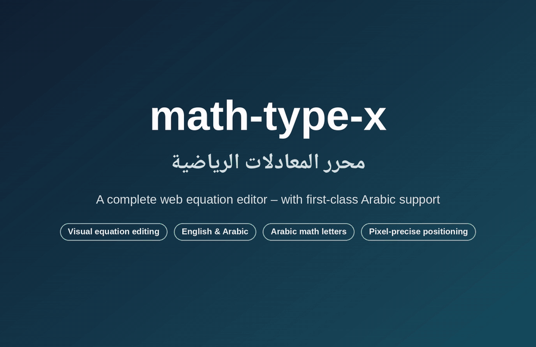

<sub>60-second tour, no sound · <a href="docs/media/demo.mp4">watch it in full quality (MP4)</a></sub>

<br>


[Features](#features) · [Turn on Arabic](#turn-on-arabic) · [Arabic mathematics](#arabic-mathematics) · [Quick start](#quick-start) · [Use it on your site](#use-it-on-your-website) · [Documentation](#documentation)

**[Try it online → mohammad-erhim.github.io/math-type-x](https://mohammad-erhim.github.io/math-type-x/)** (install it to use it offline) · [بالعربية](https://mohammad-erhim.github.io/math-type-x/ar/)

</div>

---

## Why MathTypeX?

* **It feels like a word processor for equations.** A toolbar with 700 ready-made structures, a keyboard shortcut for
  everything, and a live preview – no code to learn.
* **Complete in English, outstanding in Arabic.** The full editor works in English; switch to Arabic and the whole interface,
  the typing rules, the layout and the exports work right to left, with Arabic mathematical letters built in.
* **Your formulas are yours.** Everything is stored as standard MathML, so it works in web pages, e-books and other
  editors, and exports to PNG images.
* **Nothing to install – or install it as an app.** It is a web page that runs in any modern browser on a computer, a tablet or a
  phone. Add it to your home screen or desktop and it opens straight to the editor in its own window and **works offline**.

## Turn on Arabic

Arabic is one switch away – pick the way that suits you:

**1. Start in Arabic.** Open the editor with `?lang=ar` in the address (for example `http://localhost:8080/?lang=ar`), or pass
`language: 'ar'` when you embed it. The interface is translated and right-to-left editing is already on.

**2. Already in English?** Use the three numbered buttons of the **General** tab:

<p align="center">
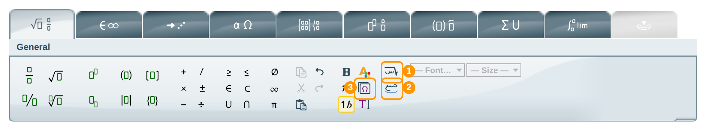
</p>

1. **Right to left editing** – formulas grow from the right and structures are mirrored. Click again to go back to left to right.
2. **Arabic ligature** – the Arabic letters you type join into one connected word. Leave it off to keep every letter separate, the
   way variables are written in a formula.
3. **Insert special characters** – opens the character panel; choose **Arabic math letters** in the list to get the Arabic
   mathematical letters and the derivative marks.

For Arabic-Indic digits (٠١٢٣…) open the **Greek, letters and numbers** tab and use the numeral buttons.

## Features

<table>
<tr>
<td width="50%" valign="top">

**Build formulas by clicking or typing**

Fractions, roots, powers, matrices, integrals, sums, limits, long division – pick them from the toolbar or type them.
Undo and redo, copy and paste, bold and italic, colours and sizes all behave as you expect.

</td>
<td width="50%" valign="top">

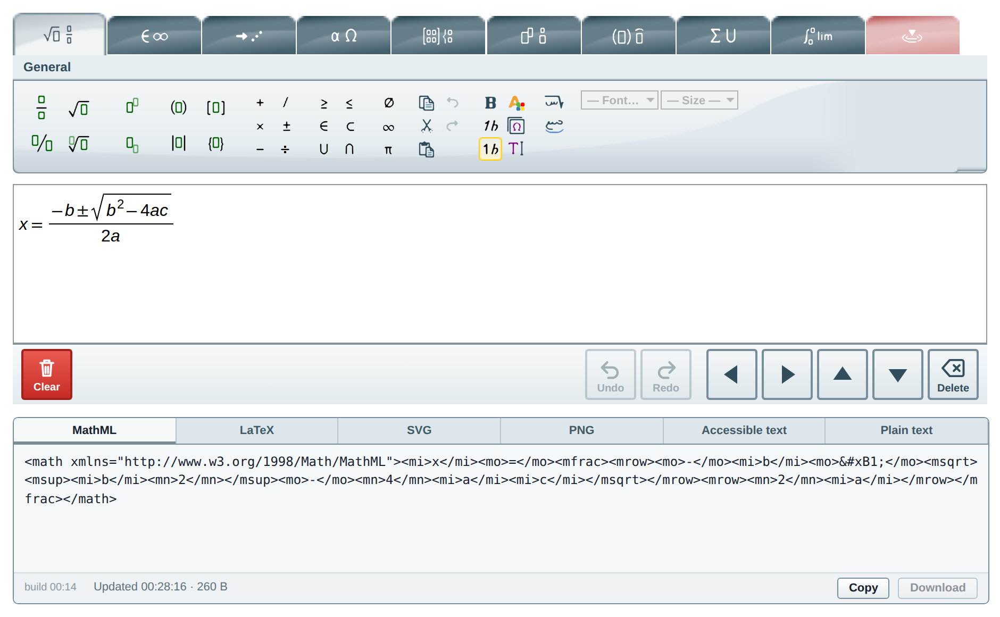

</td>
</tr>
<tr>
<td width="50%" valign="top">

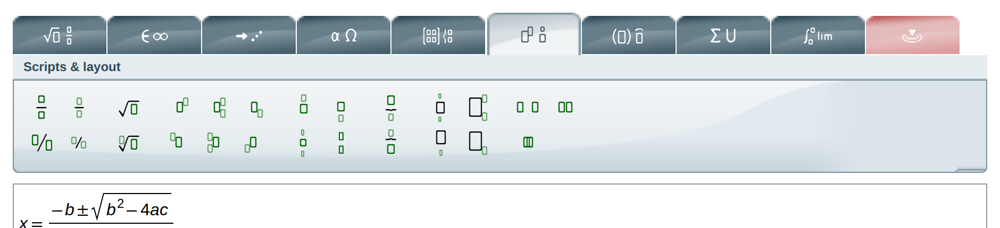

</td>
<td width="50%" valign="top">

**Everything is one click away**

Nine tabs – general, symbols, arrows, Greek letters, matrices, scripts and layout, decorations, big operators and calculus –
plus a **contextual tab** that offers exactly the controls that make sense for what is selected.

</td>
</tr>
<tr>
<td width="50%" valign="top">

**Keyboard friendly**

Shortcuts for the common structures (<kbd>Ctrl</kbd> + <kbd>/</kbd> for a fraction, <kbd>Ctrl</kbd> + <kbd>↑</kbd> for a superscript),
arrow-key navigation through every structure, and select, copy and paste like in a text editor.

</td>
<td width="50%" valign="top">

**Copy, export, share**

Export the formula as a **PNG image**, with Arabic text shaped correctly, on a **white** (default) or a **transparent**
background. The output panel opens on PNG; see the picture live, then copy, share or download it.

</td>
</tr>
</table>

<p align="center">
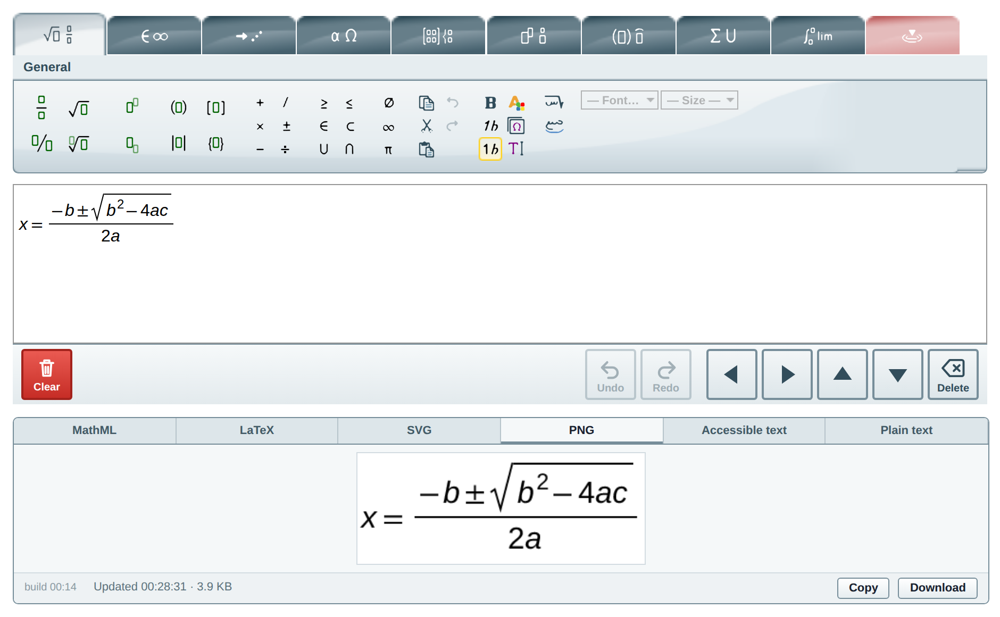
</p>

## Arabic mathematics

On top of the full English editor, Arabic gets dedicated support: the interface, the typing, the layout, the symbols and
the exports. See [Turn on Arabic](#turn-on-arabic) for how to switch.

<p align="center">
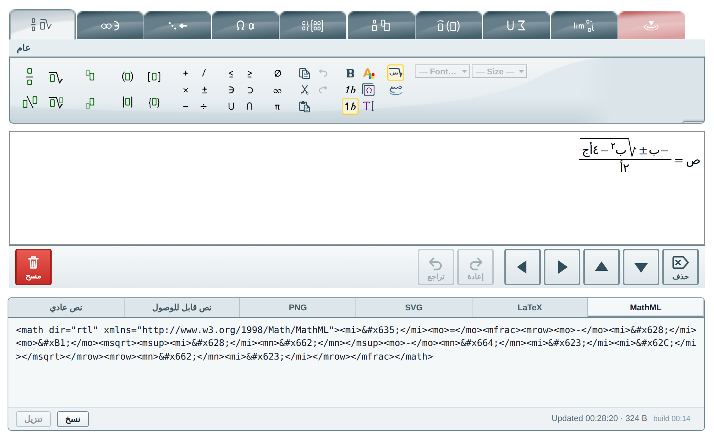
</p>

* **Right-to-left editing.** Formulas grow from the right. Fractions, roots, powers, matrices and brackets are mirrored the
  way Arabic mathematics is printed, and the toolbar, pop-ups and output panel follow.
* **Arabic interface.** Every tab, tooltip, dialog and panel is translated.
* **Arabic digits and letters.** Type with your Arabic keyboard; digits default to Arabic-Indic (٠١٢٣…), and the numeral
  buttons of the toolbar also offer Western and Eastern Arabic-Indic digits.
* **Arabic fonts.** Choose Noto Naskh, Noto Sans Arabic, Noto Kufi Arabic or Tajawal for Arabic text. The same fonts are used in
  the editor and in every export, so what you see is what you get.
* **Arabic function names and calculus.** Controls that carry a differential use the Arabic letter, and common functions
  appear with their Arabic names.

### The Arabic math letters

A palette of **Arabic mathematical letters** – the shapes used in printed Arabic mathematics – is one click away
(*Insert special characters*). They are drawn as vector shapes, so they look the same on every device and in every exported
image, with no font to install.

<p align="center">
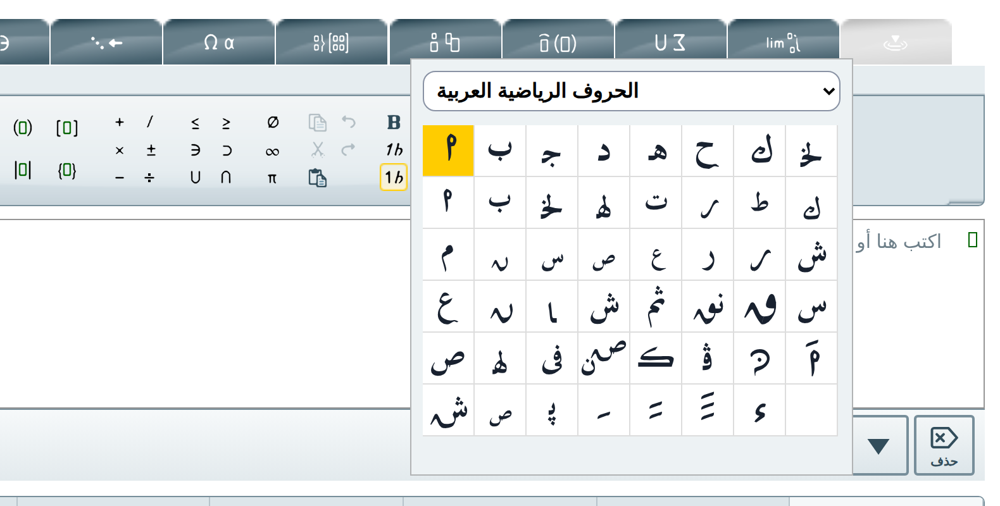
</p>

They are aligned to sit on the same line as ordinary Arabic text. Here every ordinary letter is followed by its math letter:

<p align="center">
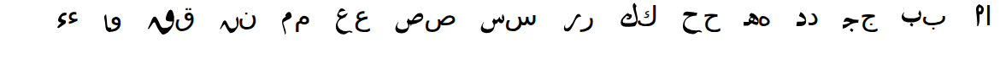
</p>

### Derivative marks

The same palette has the **1, 2 and 3 derivative marks**. Put them above a letter and they stand clear of it, never touching or
crossing it; stack more marks as high as you need.

<p align="center">
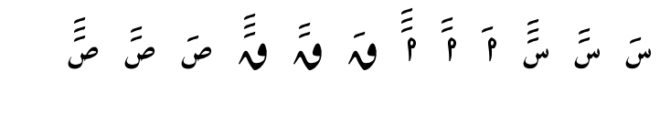
</p>

### Exact position control

Printed mathematics sometimes needs a mark or a letter to sit a pixel or two away from where an automatic layout puts it.
Select anything – a letter, a mark, a whole group – and open the **contextual tab**: four arrows move it **pixel by pixel**.
The offset is saved inside the formula (as standard MathML), so it survives copy and paste and appears in every export.

<p align="center">
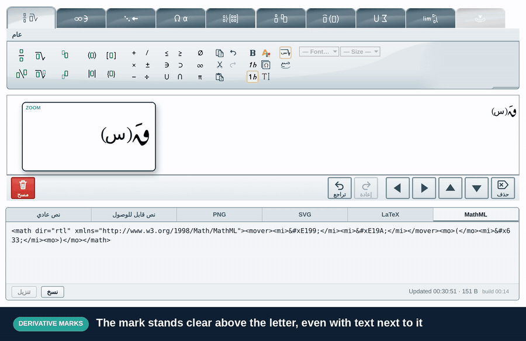<br>
<sub>Moving a mark three pixels right and three up – the offset is saved in the formula.</sub>
</p>

* Click the arrows in the contextual tab, **or** press <kbd>Ctrl</kbd> + <kbd>Shift</kbd> + an arrow key.
* Several selected elements move together.
* There is a separate control, *Elements stacked, same size* (Scripts and layout tab), for two items one above the other at
  full size – nest it for as many levels as you need.

## Install it as an app – works offline

MathTypeX is an installable web app (PWA). Install it once and it opens like any other app, straight to the editor, even with
no internet connection.

| Where | How |
| --- | --- |
| Android – Chrome | Tap the **Install app** button (the download icon in the bottom bar of the phone editor, or the button on the website), or use the browser menu → *Install app* |
| iPhone and iPad – Safari | **Share** → **Add to Home Screen** |
| Windows, Mac, Linux – Chrome or Edge | **Install app** in the editor's top bar or on the website, or the install icon in the address bar |

* **Works offline.** After the first visit the pages, the editor, its fonts and the image export are saved on the device by a
  service worker. Equations, PNG / SVG export and conversions all run in the browser, so nothing needs a connection.
* **Only the editor.** The installed app shows the editor and the language switch – no website menu, no home link, no install
  button. Any website page opened inside the app goes to the editor in the same language.
* **Always current.** While you are online the app asks for a fresh copy of each page, and a new version replaces the saved one
  (no manual update). The install button appears only when the browser offers the installation.
* **Private.** The saved files are the public site files; no equation or personal data is in them.

## Works on phones and tablets

On small screens the editor switches to a fluid layout: bigger touch targets, an on-screen arrow pad (the soft keyboard has
none), and the output as a slide-up bar. In the full-page editor:

* the text area gets the whole height – there is no top bar, the language switch sits next to **Export** in the bottom bar, and
  that bar steps aside while the keyboard is open;
* tabs, toolbar and text area share the same width; long palettes wrap into rows that fit the screen and the periodic table is
  shown whole;
* the export footer is one line: **White | Transparent** background, Share, Copy, Download;
* leaving by the logo or the language button, and clearing the formula, ask for confirmation first;
* in Arabic the tabs and the toolbar start from the right, and switching language resets the language options
  (direction, font, Arabic ligature, digits) to the new language's defaults – your equation stays.

<p align="center">
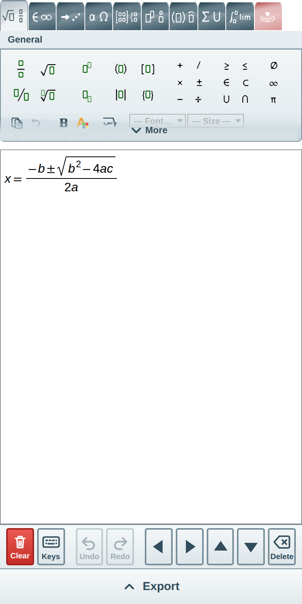
</p>

## Quick start

You need [Node.js](https://nodejs.org/) 22 or newer.

```bash
npm install
npm run build
npm start
```

Open **http://localhost:8080** – the editor and its output panel are ready. Add `?lang=ar` for the Arabic interface.

| Useful keys | |
| --- | --- |
| <kbd>Alt</kbd> + <kbd>1</kbd> … <kbd>9</kbd>, <kbd>0</kbd> | Switch toolbar tab (<kbd>0</kbd> is the contextual tab) |
| <kbd>Ctrl</kbd> + <kbd>/</kbd> | Fraction |
| <kbd>Ctrl</kbd> + <kbd>↑</kbd> / <kbd>↓</kbd> | Superscript / subscript |
| <kbd>Shift</kbd> + arrows | Select |
| <kbd>Ctrl</kbd> + <kbd>Shift</kbd> + arrows | Move the selection by one pixel |

No server? `npm run build:static` produces plain files you can host anywhere (GitHub Pages, Netlify and others); the editor then
makes its images and conversions in the browser.

## Use it on your website

```html
<div id="editorContainer"></div>
<script src="editor.js"></script>
<script>
  const editor = MathTypeX.JsEditor.newInstance({ language: 'ar' });   // or 'en'
  editor.insertInto(document.getElementById('editorContainer'));
  editor.on('change', (e) => console.log(e.mathml));                  // the formula as MathML
</script>
```

Read the formula with `editor.getMathML()`, `getLaTeX()`, `getSVG()`, `getPNG()` or `getAccessibleText()`; set one with
`setMathML()`. The full API is in the [technical reference](docs/TECHNICAL.md#embedding).

## Documentation

| | |
| --- | --- |
| [Technical reference](docs/TECHNICAL.md) | Build and deploy, source layout, embedding API, HTTP services, how it is tested, known differences |
| [Architecture](docs/ARCHITECTURE.md) | How the editor, layout engine and services fit together |
| [Services](docs/SERVICES.md) | The HTTP services behind images and conversions |
| [Testing](docs/TESTING.md) | Test suites and how to extend them |
| [Changelog](CHANGELOG.md) · [Contributing](CONTRIBUTING.md) | Release notes · how to help |

## Credits

The Arabic math letters are shapes from the symbol tables of the *Zulfi Math* Arabic keyboard maps. Formulas are drawn with the
bundled STIX Two Math, Liberation Sans and Noto Arabic faces.

